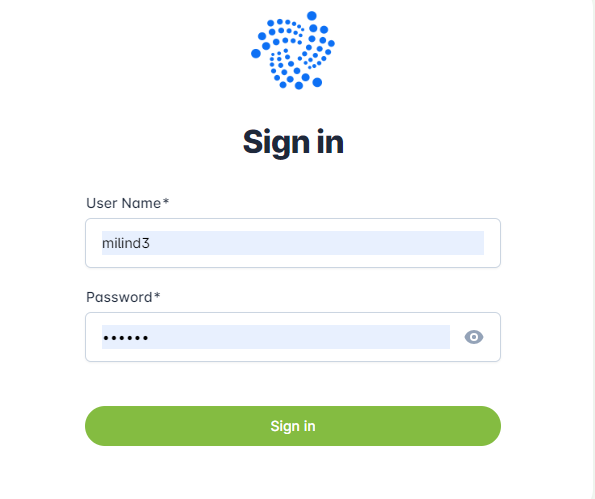
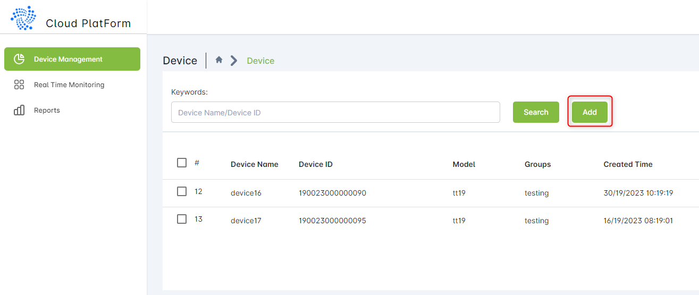
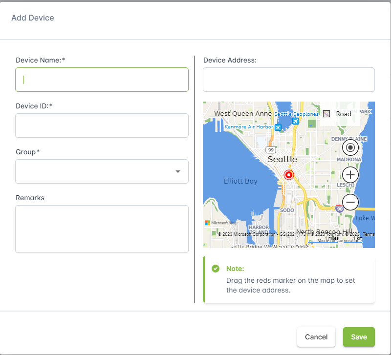
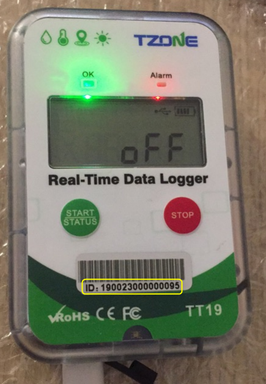
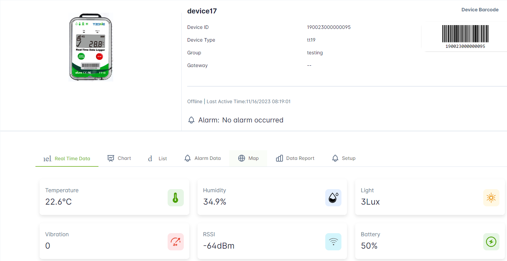
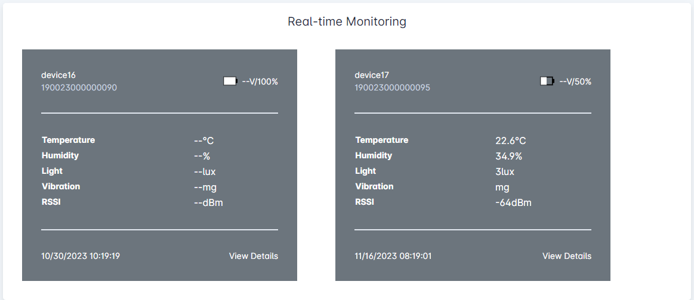

# Angular APP for real time data logger monitoring
This app is used to display the log datas of Tzone data logger device. Tested in TT19. 
 kitkat - Admin template and Starter project for Angular


## 1. Run server
### 1) Install software dependencies
- [Install node and npm in windows10 64bit server](https://phoenixnap.com/kb/install-node-js-npm-on-windows).   
  - Download [last node version](https://nodejs.org/en/download)
  - Install node and npm
  - check the installed version
  ```shell
  $ node --version
  v18.17.1
  $ npm --version
  9.6.7
  ```
- Install software dependencies.  
 Open terminal in source root directory, run. 
 `npm install`  
This command will install all dependencies

### 2) Run dev server
- Open terminal in source root directory, run `ng serve` . Navigate to `http://localhost:4200/`. The application will automatically reload if you change any of the source files.  
__*NOTE:*__ 
```
You must confirm that API server is already running on `localhost:9000`. 
```
## 3) build app in product env
Open terminal in source root directory, run `ng build` to build the project. The build artifacts will be stored in the `dist/` directory.

```shell
npm install -g http-server
cd dist
http-server -p 4200
```
Launch angular app with HTTPS server
```shell
ng serve --ssl
```


## 2. How to use software. 
### 1) Sign up/Log in. 
The user `sign-up` isn't implemented yet, because this app is used to test the API of backend server. So an user should to add user name and password into server database manually. The this user information could be used for login.   


### 2) Add Device
- click __Add__ button 

- Input the each field 
  
Where
  - `Device Name`: Any string of device label. 
  - `Device ID`: Serial number which is visible on the front of device:   
      
  - `Group`: optional string
  - `Remarks`:  optional string
  - Device address: optional string

### 3) check the device state




